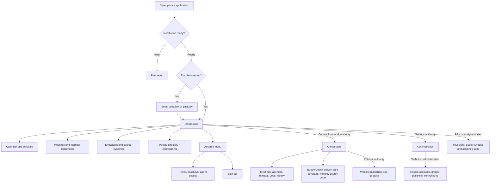
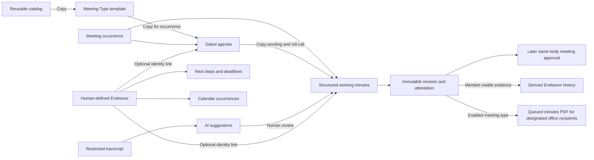

# LegionPostTools application map

Source baseline: `5adda175d67e9603f58fdf8574ad6f7a0313d6b9` (`main`), reviewed
October 10, 2026. This is the initial repository-based discovery reference. It does
not establish the deployed revision, installation configuration, browser behavior,
test coverage, or defect detection.

LegionPostTools helps an American Legion Post preserve meeting records and continue
Post work across officer turnover. Meeting records are the primary workflow;
Endeavors, the member directory, calendar, and reviewed website content support it.
Post 165 grounds product policy without becoming a hard-coded installation assumption.

## Reading the map

| Reference | Job |
| --- | --- |
| [Testing and workflow validation](TESTING.md) | Standing method for independent expectations, realistic variants, useful assertions, and regression detection |
| [Interfaces](application_map/INTERFACES.md) | Pages, forms, controls, API families, navigation, and their authority boundaries |
| [Workflows](application_map/WORKFLOWS.md) | Stable behavior IDs, starting states, actions, results, later interactions, and failure cases |
| [Source inventory](application_map/SOURCE_INVENTORY.md) | Exhaustive local controller, view, JavaScript, and job discovery ledger |
| [Maintenance and evidence](application_map/MAINTENANCE.md) | Source discrepancies, discovery limits, change procedure, and the handoff to test review |

The inventory answers **what exists**. Workflow contracts answer **what a person
should be able to accomplish**. A controller or test is evidence to inspect, not an
independent definition of correctness.

**Expected** behavior comes from current product policy and explicit requirements.
**Located** means a matching source path was found; it does not mean the behavior
has passed a runtime check. **Discrepancy** means policy and source differ or older
documents conflict. **Planned** means a desired capability has no current mapped
interface. Every workflow below is source-located, runtime-unverified, and
coverage-not-assessed unless its entry says otherwise. These dimensions remain separate.

The [October 11 review report](testing/OVERNIGHT_HANDOFF_2026-10-11.md) records later
scoped testing and corrections. Read its evidence and linked variant reviews alongside
this initial discovery baseline; it does not make every mapped variant or production
behavior verified.

Current [minutes approval and attestation](MINUTES_APPROVAL_AND_ATTESTATION.md),
[roles](ROLES.md), [automatic website calendar](AUTOMATIC_WEBSITE_CALENDAR.md), and
[website connections](WEBSITE_CONNECTIONS.md) supersede older descriptions on their
subjects. Unresolved differences are retained in the evidence guide.

## People and authority

Authority belongs to a person. `Person` is the Post record; `User` is the ability to
sign in; a dated `PositionAssignment` represents Post office; application grants
represent specific duties. Not every person has an account. An agent is a channel
acting for a person and inherits that person's current authority.

| Actor or state | Expected boundary | Current source |
| --- | --- | --- |
| Anonymous visitor | Setup on a fresh installation; email/passkey sign-in; no private Post records | [Application controller](../app/controllers/application_controller.rb), [setup](../app/controllers/setup_controller.rb), [sessions](../app/controllers/sessions_controller.rb) |
| Enabled signed-in member | Dashboard, calendar, Meetings and published/attested documents, Endeavors, visible directory, own Profile/passkeys/agent access | [Navigation](../app/helpers/navigation_helper.rb), member controllers |
| Current Commander in the standard preset | Full membership; agenda work, minutes drafting, Commander handoff, recording later meeting approval; private notes and calendar management | [Preset](../app/services/american_legion_post_preset.rb), [User policy](../app/models/user.rb) |
| Current Adjutant in the standard preset | Full membership; agenda work, minutes drafting, attestation, recording later meeting approval; private notes and calendar management | Same sources |
| Current 1st Vice Commander in the standard preset | Full membership without meeting-management or technical-administrator duties | Same sources |
| Other officers, former officers, honorary status | Member baseline plus actual current assignments/manual grants; a display title never substitutes for authority | [Roles](ROLES.md), [assignments](../app/models/position_assignment.rb) |
| Scoped duty holder | Only operations covered by effective capabilities; Officer tools hub for current membership leadership or operational capabilities | [Permission grants](../app/models/permission_grant.rb), [hub](../app/controllers/officer_tools_controller.rb) |
| Technical administrator | Account/grant/position/roster/website-connection administration and implied operational support | [Admin base](../app/controllers/admin/base_controller.rb), [Permission grants](../app/models/permission_grant.rb) |
| Publisher | Separate `publish_public_content` grant: introduction/portrait/consent/editorial work and calendar defaults | [Publishing](PUBLIC_PUBLISHING.md) |
| Personal agent token | Private `/api`; current enabled user's effective authority; expiry/revocation and idempotency checks | [API base](../app/controllers/api/base_controller.rb), [token](../app/models/agent_access_token.rb) |
| Post-owned website token | Organization-scoped approved website feed only; independent of creator's continued login authority | [Website connections](WEBSITE_CONNECTIONS.md), [feed controller](../app/controllers/public/v1/publications_controller.rb) |

The website feed's [public officers API](PUBLIC_OFFICERS_API.md) returns currently
listed officer names, saved role guidance and the general Post email under an
explicit public-listing policy. Its [OpenAPI contract](api/public-officers.openapi.json)
and [website handoff](PUBLIC_OFFICERS_WEBSITE_HANDOFF.md) document the consumer boundary;
personal officer contacts and private member fields remain excluded.

This is preset policy, not a statement about any live officer, grant, or token.
Position authority requires an active position and an assignment current on the
installation's date, including its end date. Manual grants remain independent.

| Capability/predicate | Meaning and exceptions |
| --- | --- |
| `manage_settings` | Technical administration; implies `manage_people`, `manage_meeting_bodies`, `manage_agendas`, `manage_minutes`, `view_internal_records` for support |
| `manage_people` / `full_membership_access?` | Complete membership visibility; current positions can provide it separately from administration |
| `manage_meeting_bodies` | Stored meeting-type capability; current meeting-type/template controllers require `manage_agendas`; no standalone Meeting Body management page is routed |
| `manage_agendas` | Meeting scheduling, catalog/templates, dated agendas, Endeavor/task editing, history operations |
| `manage_minutes` | Working structured minutes, restricted transcript writes, AI review, audited reopening |
| `approve_minutes` | Identity-bound Commander draft handoff; does not mean the Meeting Body approved the record |
| `attest_minutes` | Identity-bound attestation of the exact current text |
| `record_minutes_approval` | Record the real later same-body meeting's approval; no implied approval from being an administrator |
| `view_internal_records` | Restricted minutes/transcript reading; does not allow drafting or AI-run management |
| `publish_public_content` | Separate editorial authority; never implied by `manage_settings` or granted by first setup |
| `private_agenda_notes_access?` | Current position-derived `approve_minutes` or `attest_minutes`; a manual capability alone does not supply this access |
| `can_manage_calendar?` | `manage_settings` or the preceding current-position predicate; manual agenda/approval grants alone are insufficient |

Source: [User](../app/models/user.rb), [PermissionGrant](../app/models/permission_grant.rb),
controller guards in the [inventory](application_map/SOURCE_INVENTORY.md).

## Navigation and entry points

Desktop tabs and the phone Menu share Dashboard, Calendar, Meetings, Endeavors,
People. Menu separates Your work, Post duties, Application settings, and Your account.
Officer tools and Administration are separate hubs; people with both kinds of authority
see both. Buddy Checks and assigned calls stay under Your work; Profile and Sign out
stay under Your account. Each destination still checks its own
authority; hiding a link is not the access control. Legacy `/dated_agendas` lists
redirect to Meetings; officer agenda lists redirect to officer Meetings.
Source: [navigation helper](../app/helpers/navigation_helper.rb),
[header](../app/views/shared/_app_header.html.erb),
[primary navigation](../app/views/shared/_primary_nav.html.erb).

## Records and state transitions

Copies preserve meeting-specific wording and heading/place snapshots. Source IDs
retain lineage; later catalog/template/Endeavor changes must not rewrite dated or
official documents. AI history and officer updates are explanations and continuity
evidence, never substitutes for official minutes.

| Record/channel | Starting/next states | Observable boundary |
| --- | --- | --- |
| Sign-in challenge | Created → used, expired, or exhausted | Email GET opens confirmation; successful POST signs in; invalid/reused/disabled challenge grants no session |
| Browser session | Active → signed out, inactive too long, account disabled, or missing | Current source uses 180-day inactivity; privileged fresh-auth window is 10 minutes; protected requests after invalidation require sign-in |
| Personal token | Active → expired/revoked or owner disabled | Delegated calls stop; later grant/assignment changes alter authority without reissuing the token |
| Agenda | `draft` → `approved` → `published`; approved/published → reopened draft | Only published member HTML/PDF; reopening removes member availability until republished |
| Minutes draft | `draft` → optional legacy `approved` handoff | Both states remain editable; neither publishes first-time minutes to members |
| Attestation | Editable draft/handoff → `attested` | Exact immutable copy becomes readable, awaiting later meeting approval |
| Ordinary correction | Attested → audited reopened draft → new attestation | Members retain the last attested copy during editing |
| Meeting approval | Attested → `membership_approved` | Real later same-body meeting and disposition bind the exact revision; official record locks |
| Approval with pending corrections | Attested → draft with immutable decision → final Adjutant attestation → `membership_approved` | Corrections link to the already-recorded approval; no invented second vote |
| Transcript | One pasted/plain-text source; retention choice stored; optional purged metadata | Restricted read, no member document leakage; purge scheduling/UI are not mapped as implemented |
| AI minutes run | `pending` → `running` → `succeeded`/`failed` | Suggestions await human review; failed-run discard hides attention only; retry is a new linked attempt |
| Endeavor | Active → completed → reopened | Identity/history remain; completion does not cascade into tasks/events |
| Task | Open ↔ completed | Completion actor/time retained; optional due date separate from event schedule |
| Event | Scheduled ↔ cancelled; deletable ordinary event → removed | Meetings use their own occurrence/document rules; meeting-like calendar entries cannot be deleted as ordinary events |
| Roster import | Completed/failed or pending confirmation → completed/discarded | Pending/superseded confirmation must not silently remove members; histories retained |
| Loops sync | Queued → running → completed/failed | Owns Post members only; preserves minutes/other lists and opt-outs; counts/progress expose partial success |
| Minutes distribution | Attestation intent → pending/ready → completed, held, superseded or needs attention | Only designated, active website office entries with effective Minutes recipients enrollment; original destinations and submitted payloads are retained |
| Introduction | Working draft → consent/review → published snapshot → withdrawn | Saving does not publish; consent matches text and portrait; withdrawal removes feed/portrait access |
| Website calendar | Legacy snapshots → reviewed activation → live policy listings | One-way activation, explicit stored types and Show/Hide overrides; attendance and website visibility are separate |

Sources: models named in the [source inventory](application_map/SOURCE_INVENTORY.md),
[minutes policy](MINUTES_APPROVAL_AND_ATTESTATION.md),
[publishing policy](PUBLIC_PUBLISHING.md). See the workflow contracts for each branch.

## Application boundaries and dependencies

| Boundary | User-visible dependency / expected failure behavior |
| --- | --- |
| Rails routing, middleware, cookies, CSRF, Turbo | Actual Sign out/form controls must complete the intended method and transition. An isolated service call is insufficient evidence. HTML denials usually redirect; API denials use JSON statuses. |
| PostgreSQL transactions, foreign keys, optimistic locks | Saves persist completely or fail visibly; stale edits require review; official revisions/events are immutable. Session deletion must preserve historical confirmation records. |
| Action Text/Lexxy and Stimulus | Rich text and order survive saving/reloading; menus, confirmation dialogs, date/time inputs, pickers, source reader, passkeys, and run monitoring must work through their real controls. |
| MailDelivery / Action Mailer or Loops | Email identity flows depend on delivery. A generic “check email” notice does not prove delivery or account existence. Minutes distribution separately uses Loops transactional PDF attachments with per-address identity/subscription checks; see MIN-13. |
| WebAuthn and browser platform | Passkeys need supported browser/origin/authenticator and user verification. Cancellation or failed verification must not create credentials or sessions. |
| Active Storage | Authorized roster/transcript uploads only; application direct uploads return 404. Attachment-engine routes are technical exposure, not a general file cabinet. |
| Chromium PDF renderer | Inline PDF delivery depends on runtime Chromium, signed loopback source, resource allowlist, and timeout; controlled failure returns guidance rather than a partial document. |
| Solid Queue worker / recurring jobs | AI drafts, Loops sync, minutes distribution/reconciliation, derived-history work, cleanup; queue health and recorded run state are separate evidence. Viewing a status page must not itself start paid generation. |
| OpenAI | Minutes suggestions and derived Endeavor history depend on provider/configuration/budget/source checks. Synthetic tests may verify mechanics; live model quality and paid recovery require separate evidence/authority. |
| Website consumer | A separate site fetches feed JSON/portraits server-side with a Post token and obeys private caching/revocation. Publisher source checks do not prove companion rendering. |

Configuration evidence lives in [Gemfile](../Gemfile), [importmap](../config/importmap.rb),
[recurring jobs](../config/recurring.yml), services/jobs, and
[deployment guide](DEPLOYMENT.md). No current provider account, worker, email service,
consumer, or production activation was checked by this mapping pass.

Subsequent scoped update, October 19, 2026: minutes email distribution and Post members
sync ownership were traced at `7d60cca71efda7883958f6758530afee3fe21e5d`. The
[Post 165 activation record](MINUTES_EMAIL_DISTRIBUTION.md#post-165-live-setup-verified-october-19-2026)
records the separate live setup and provider read-back evidence. It does not establish
production behavior for unrelated workflows or actual inbox delivery.

## Validation priorities

Workflow IDs are the future review unit; route counts and test counts are not
reliability measures. `P0` is the strongest validation priority, then `P1`, then `P2`.
These labels do not assert current defects or dictate that every case needs a browser.

| Priority | Why | Initial subjects |
| --- | --- | --- |
| P0 | Loss of authentication/privacy, official-record truth, publication consent, or durable historical content | Sign in/out/revocation; permission changes; member/draft separation; snapshots; attestation/approval/corrections; website restriction and token revocation |
| P1 | Primary Post work, persistence, destructive actions, or asynchronous recovery | Meeting/agenda preparation; record editing; roster imports; tasks/calendar; AI review/retry; history sources; PDFs; API idempotency |
| P2 | Navigation, optional guidance, discovery, and presentation | Menu and Profile paths, dashboard selection, directory usability, filters and no-data states |

A full test-effectiveness audit, defect injection, nightly review, and workflow-based
test implementation are follow-on initiatives. This pass changes documentation only.
See [maintenance](application_map/MAINTENANCE.md) for the evidence boundary and next work.
